<div align="center">

# 🛡️ Penetration Testing Report

**Footprinting, Reconnaissance & Network Scanning Phases**

*W2-PM-FINAL · Cybersecurity Internship · Networkwalks · Week 02*

</div>

<p align="center">
  
  
  
  
  
</p>

---

| | |
|---|---|
| **Pentester Name (Cybersecurity Intern)** | Muhammad Ahmad Abdullahi |
| **Program / Batch** | B084 · Networkwalks |
| **Report Date** | 13 November 2026 (testing carried out on 11 November 2026) |
| **Modules Completed** | W2-PM1 (Multiple Kali Tools) · W2-PM2 (GHDB) · W2-PM3 (Maltego) · W2-PM4 (theHarvester) · W2-PM5 (Zenmap Scanning) |
| **Client / Target** | 1. networkwalks.com (written permission secured) 2. My own local LAN (`10.27.215.0/24`) 3. microsoft.com: passive OSINT only, as set in module W2-PM4 |
| **Permission Secured?** | Yes. Letter of Authorization **NW-B084-2TI**, issued by the Networkwalks Managing Director, valid 08 Nov 2026 to 13 Nov 2026 |
| **Phases Covered** | **Phase 1:** Reconnaissance & Footprinting · **Phase 2:** Scanning & Network Discovery · **Phases 3-5:** In progress |

---

## 📑 Table of Contents

1. [Liability Disclaimer](#1-liability-disclaimer)
2. [Introduction](#2-introduction)
3. [Tools Used](#3-tools-used)
4. [Activities Performed](#4-activities-performed)
5. [Risk Analysis / Impact](#5-risk-analysis--impact)
6. [Recommendations](#6-recommendations)
7. [Conclusion](#7-conclusion)
8. [Evidences Collected](#8-evidences-collected)

---

## 1. Liability Disclaimer

> ⚠️ I performed these activities only on systems and devices where I had written permission, or on devices I own myself. All material here is for **education and research purposes only**. Do not use anything from this report to break the law. The instructor, the authors and Networkwalks are not responsible for what you do with this knowledge. Every action you take is your own responsibility. In most countries, unauthorised access is a crime even when nothing is damaged.

---

## 2. Introduction

This report covers Week 2 of the Networkwalks Cybersecurity Internship (Batch B084). It documents **Phase 1 (Reconnaissance & Footprinting)** and **Phase 2 (Scanning & Network Discovery)** of a penetration test, and shows how an attacker moves from gathering public information to mapping live hosts on a network.

- **Footprinting (W2-PM1):** six Kali Linux tools were used against `networkwalks.com`.
- **OSINT (W2-PM2 to W2-PM4):** Google Hacking Database dorks, Maltego, and theHarvester.
- **Network scanning (W2-PM5):** Zenmap was used to discover live hosts on my own LAN, `10.27.215.0/24`.

Every step below includes the exact command used, the result I observed, a screenshot as evidence, and a short note on why the finding matters from an attacker's point of view.

---

## 3. Tools Used

| Tool | Purpose |
|---|---|
| Kali Linux | Operating system used to run the reconnaissance and scanning tools |
| WHOIS | Find domain registration details (registrar, dates, name servers) |
| WhatWeb | Fingerprint web technologies (server, CMS, plugins, IP) |
| nslookup | Resolve the domain name to its IP address using DNS |
| curl -i | Read the HTTP response headers of the website |
| wafw00f | Detect whether a Web Application Firewall protects the site |
| dnsrecon | Enumerate DNS records (SOA, NS, MX, A, TXT, SRV) |
| theHarvester | Collect emails, hosts, subdomains and ASNs from public sources |
| Maltego | Visual link analysis for OSINT |
| Google Hacking Database (GHDB) | Search dorks that reveal publicly exposed information |
| Zenmap (Nmap GUI) | Scan the local subnet to find live hosts, IPs and MAC addresses |
| `ip a` | Identify my local IP address and MAC address |

---

## 4. Activities Performed

### 4.1 Footprinting & Reconnaissance (W2-PM1)

Target: **networkwalks.com**, tested under authorization NW-B084-2TI.

#### Step 1 · Domain ownership and registration (WHOIS)

```bash
whois networkwalks.com
```

**Result**

- Registrar: GoDaddy.com, LLC (IANA ID 146)
- Created: 2019-11-06 · Registry expiry: 2027-11-06
- Name servers: `NS6135.HOSTGATOR.COM`, `NS6136.HOSTGATOR.COM`
- DNSSEC: unsigned

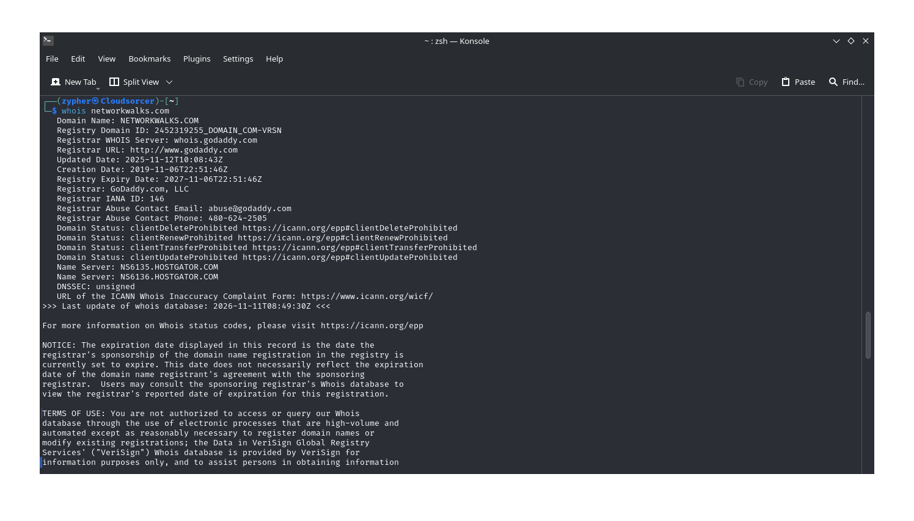

**Why it matters:** registration data and name servers show who hosts and manages the domain, which helps an attacker map the target's infrastructure. The domain is not signed with DNSSEC.

<!-- If you want to keep the "Registrant privacy: Domains By Proxy, LLC (Tempe, Arizona)" line from your draft, add a screenshot of the registrar WHOIS section that shows it. The screenshot above only shows the registry output. -->

#### Step 2 · Technology fingerprinting (WhatWeb)

```bash
whatweb networkwalks.com
```

**Result**

- HTTP redirects to HTTPS (`301 Moved Permanently`), final status `200 OK`
- Server: Apache · IP: `192.232.216.135` (United States)
- CMS and components: WordPress 7.1.4, Bootstrap 7.1.4, WordPress Download Manager 3.3.76
- Contact email disclosed: `info@networkwalks.com`
- Cookie: `__wpdm_client` (HttpOnly)

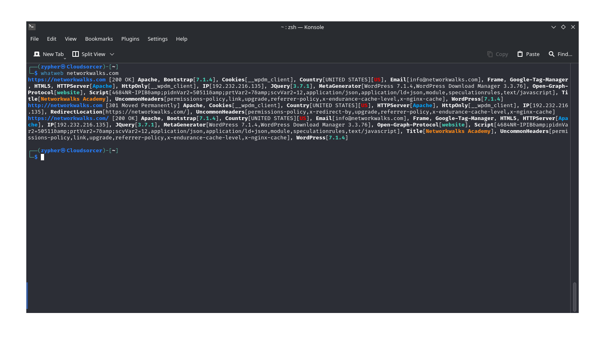

**Why it matters:** exact CMS and plugin versions let an attacker look up known weaknesses for those versions.

#### Step 3 · DNS resolution (nslookup)

```bash
nslookup networkwalks.com
```

**Result**

- Resolved IP: `192.232.216.135`
- Resolver used: local DNS server `10.27.215.166`
- A timeout message from the same resolver appeared after the answer; the A record was still returned.

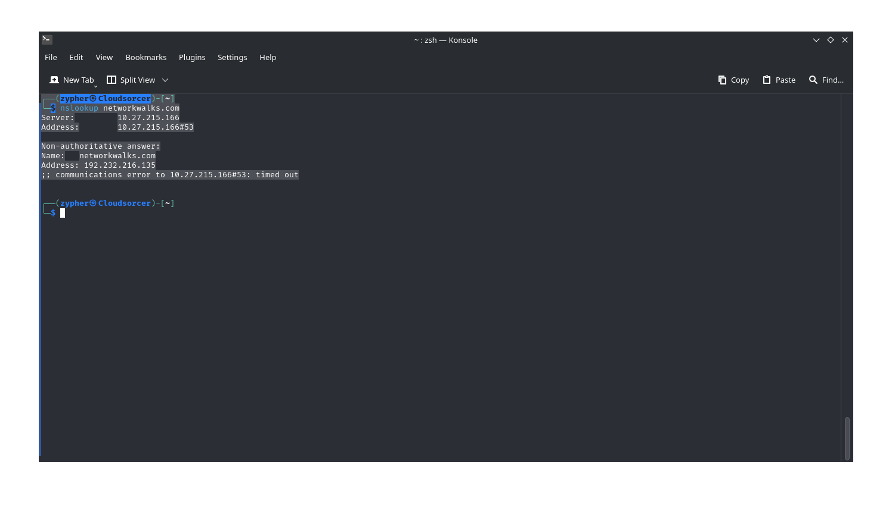

**Why it matters:** the IP address is the starting point for further scanning of the web server.

#### Step 4 · HTTP header inspection (curl)

```bash
curl -i networkwalks.com
```

**Result**

- `HTTP/1.1 301 Moved Permanently` redirecting to `https://networkwalks.com/`
- `Server: Apache`
- `X-Redirect-By: WordPress - Really Simple Security`
- `X-Endurance-Cache-Level: 0` and `X-nginx-cache: WordPress`
- `Set-Cookie: __wpdm_client=...; path=/; domain=networkwalks.com; HttpOnly` (no `Secure` flag shown)

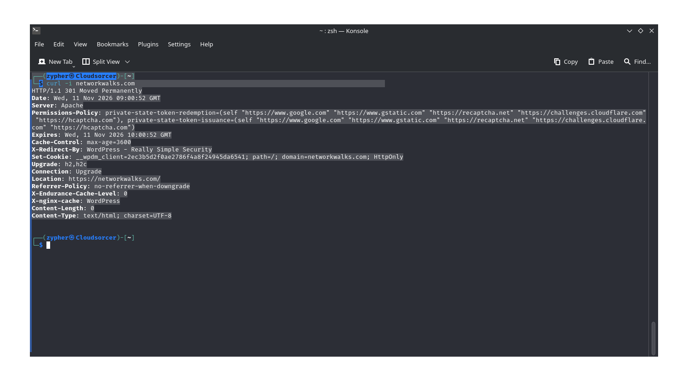

**Why it matters:** headers reveal server software, caching layers and even the security plugin in use.

#### Step 5 · Web Application Firewall detection (wafw00f)

```bash
wafw00f networkwalks.com
```

**Result:** the site is behind **ModSecurity (SpiderLabs)** WAF, detected with 2 requests.

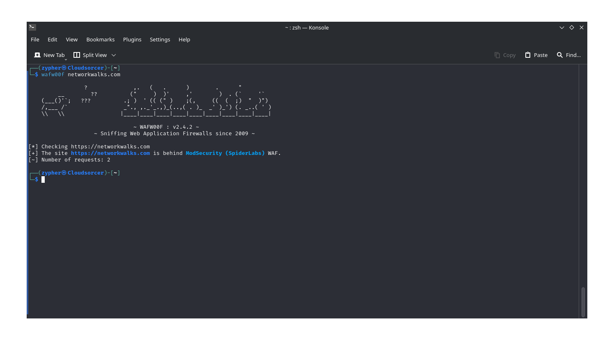

**Why it matters:** knowing a WAF is present tells an attacker to expect request filtering and to plan around it.

#### Step 6 · DNS enumeration (dnsrecon)

```bash
dnsrecon -d networkwalks.com
```

**Result**

- SOA: `ns6135.hostgator.com` (`50.87.144.87`)
- NS: `ns6136.hostgator.com` (`192.232.216.131`) and `ns6135.hostgator.com` (`50.87.144.87`), BIND version `9.16.23-RH`
- MX: `mail.networkwalks.com` (`192.232.216.135`)
- A: `networkwalks.com` (`192.232.216.135`)
- TXT: SPF policy `v=spf1 +a +mx +ip4:50.87.144.87 +include:websitewelcome.com ~all`, plus a Google site-verification record
- SRV: 8 `_autodiscover._tcp` records pointing to `cpanelemaildiscovery.cpanel.net`
- DNSSEC query: no answer

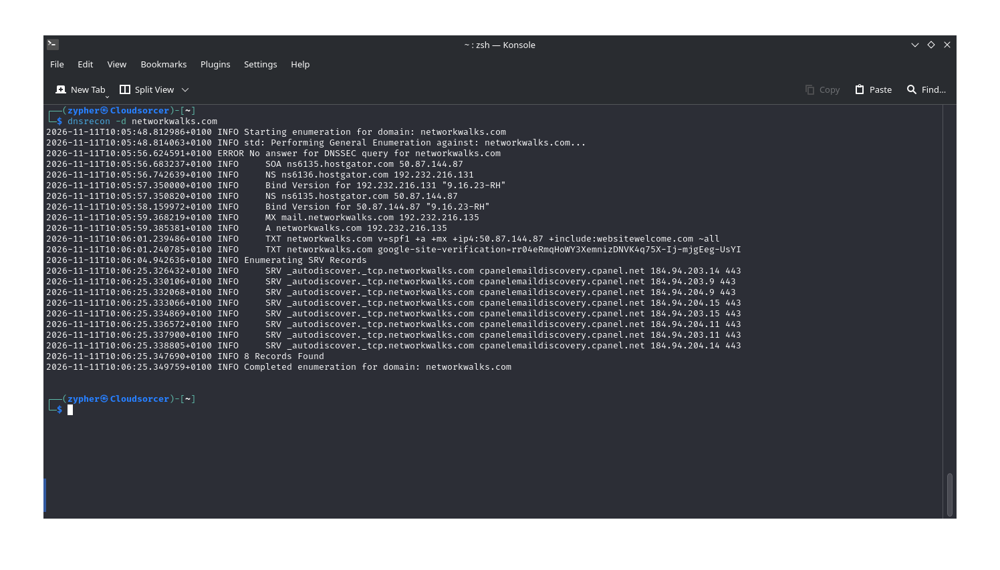

**Why it matters:** mail servers, SPF settings and DNS software versions widen the attacker's picture of the organisation's infrastructure.

---

### 4.2 Google Hacking Database & Maltego (W2-PM2, W2-PM3)

**GHDB:** I explored Exploit-DB dorks to understand which kinds of public exposure (open directories, login portals, unprotected files) can be found through search engines.

<!-- 📸 ADD SCREENSHOT: images/12-ghdb-dork-results.png
     Write the dork you ran (for example one restricted to site:networkwalks.com) and what it returned. -->

**Maltego:** I installed Maltego Community Edition, registered a Maltego ID, created a Domain entity for `networkwalks.com`, and ran transforms to look for related emails, infrastructure and DNS links.

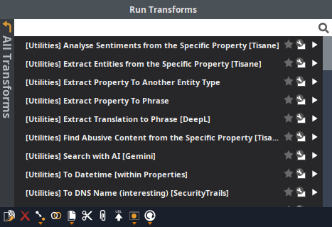

<!-- 📸 ADD SCREENSHOT: images/13-maltego-graph-results.png
     The graph after running the transforms, showing the entities that were found (for example info@networkwalks.com). -->

**Why it matters:** search-engine dorks and link analysis turn scattered public data into a map of an organisation.

---

### 4.3 theHarvester OSINT (W2-PM4)

Target: **microsoft.com**, using public sources only. No requests were sent to Microsoft's own systems as part of this exercise.

```bash
theHarvester -d microsoft.com -l 1000 -b baidu
theHarvester -d microsoft.com -l 50 -b all
```

**Result (multi-source scan)**

- Emails: `dotnet-docker-bot@microsoft.com`, `opencode@microsoft.com`, `secure@microsoft.com`
- ASNs: AS133618, AS16625, AS206834, AS20940, AS40034, AS8075
- Hosts and subdomains: more than 265 found (for example `learn.microsoft.com`, `login.microsoftonline.com`, `download.microsoft.com`)
- Several sources (for example bevigil, BuiltWith, Brave Search) were skipped because no API key was configured.

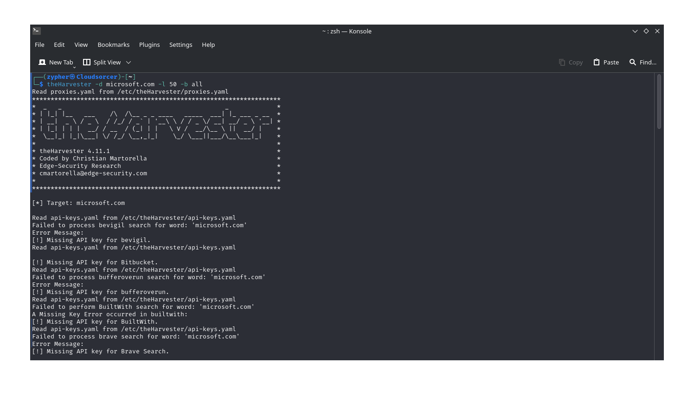

<!-- 📸 ADD SCREENSHOT: images/14-theharvester-baidu.png  (the -b baidu command)
     📸 ADD SCREENSHOT: images/15-theharvester-results.png (the end of the -b all run showing the emails, ASNs and hosts) -->

**Why it matters:** public sources alone can reveal staff-facing email addresses, network ranges and subdomains, all of which feed phishing and targeting.

---

### 4.4 Network Scanning with Zenmap (W2-PM5)

Target: my own local network.

**Step 1 · Identify my IP address and subnet**

```bash
ip a
```

Interface `wlan0`: `10.27.215.65/24`, MAC `a4:34:d9:c2:a9:25`. This gives the subnet `10.27.215.0/24`.

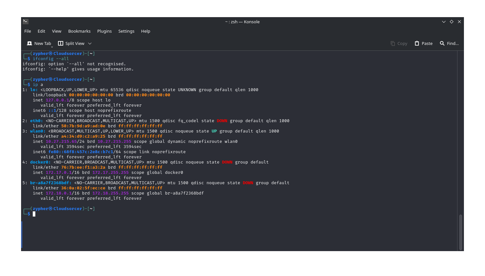

**Step 2 · Ping scan for live hosts**

In Zenmap: Target `10.27.215.0/24`, Profile **Ping scan**, which runs:

```bash
nmap -sn 10.27.215.0/24
```

**Result:** Nmap 7.99 scanned 256 addresses in 17.86 seconds and found **2 hosts up**.

| IP address | Role | MAC address |
|---|---|---|
| `10.27.215.166` | Gateway / local DNS resolver | `5A:5B:8A:40:D2:26` |
| `10.27.215.65` | My own machine (`wlan0`) | `A4:34:D9:C2:A9:25` (from `ip a`) |

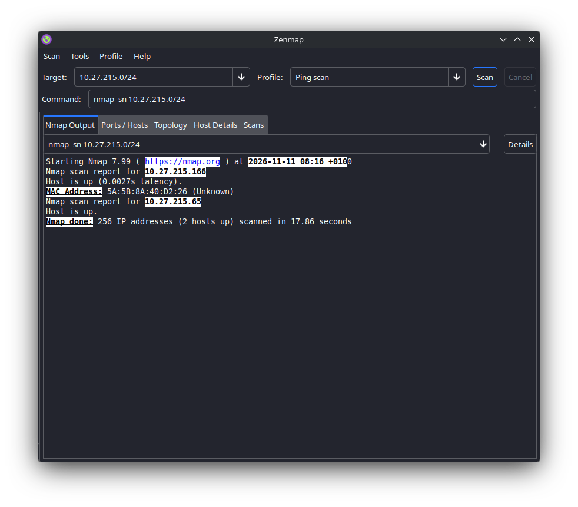

**Step 3 · Network topology**

I opened the **Topology** tab, which shows my machine (`localhost`) connected to both live hosts.

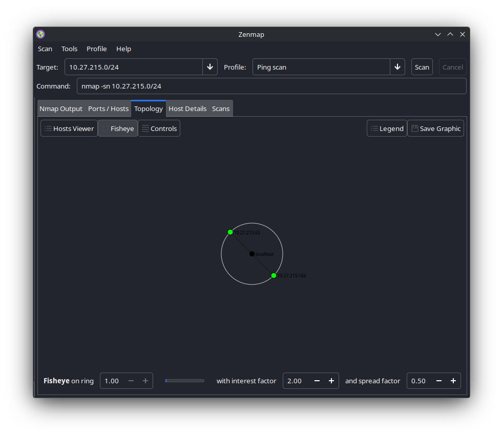

<!-- 📸 ADD SCREENSHOT: images/16-zenmap-topology-legend.png
     The task asks for the Legend to be enabled and the topology saved as a PDF (Save Graphic).
     Add the legend view and the saved PDF to the repo (e.g. evidence/zenmap-topology.pdf). -->

**Why it matters:** a ping sweep shows which devices are alive on a network, and the MAC addresses help identify each one. An unknown device in this list would deserve investigation.

---

## 5. Risk Analysis / Impact

| # | Risk / Finding | Evidence / Observation | Potential Impact | Risk Level |
|---|---|---|---|---|
| 1 | CMS and plugin versions exposed | WhatWeb showed WordPress 7.1.4 and WP Download Manager 3.3.76 | Attackers can match versions against vulnerability databases for known issues | 🟠 Medium |
| 2 | Server IP address identifiable | nslookup resolved the domain to `192.232.216.135` | Reveals where the web service is hosted and helps map the infrastructure | 🟢 Low |
| 3 | WAF technology identifiable | wafw00f identified ModSecurity (SpiderLabs) | Reveals part of the security architecture; may prompt evasion attempts | 🟢 Low |
| 4 | Email addresses discoverable | WhatWeb exposed `info@networkwalks.com`; theHarvester showed how public sources reveal emails (microsoft.com exercise) | Supports targeted phishing and social engineering | 🟠 Medium |
| 5 | DNS infrastructure information exposed | dnsrecon exposed BIND version `9.16.23-RH`, mail, SPF and SRV records | Helps build a wider profile of the attack surface | 🟠 Medium |
| 6 | Live hosts visible on the local network | Zenmap found 2 live hosts on `10.27.215.0/24` | Unknown or unauthorised devices could go unnoticed if the network is not reviewed | 🟢 Low |

**Risk level key:** 🔴 Critical · 🟠 Medium · 🟢 Low

> ℹ️ The risks above are **observations from footprinting and scanning, not confirmed vulnerabilities.** No exploitation or active vulnerability testing was performed. The presence of a software version, IP address or DNS record does not by itself mean the system is vulnerable. Further authorised testing would be needed to confirm any real weakness.

---

## 6. Recommendations

- **Minimise version disclosure:** hide CMS version banners and unnecessary server headers where possible.
- **Review HTTP headers:** check whether headers expose technical detail that is not needed.
- **Keep software updated:** update WordPress, plugins and other components, and check them against current security advisories.
- **Review exposed contact emails:** audit email addresses shown on public pages to reduce phishing risk.
- **Review DNS records regularly:** publish only the records that are needed (MX, A, TXT) and check zone-transfer permissions.
- **Keep the WAF enabled and tuned:** ModSecurity rules should stay updated and monitored.
- **Run regular internal network discovery:** scan your own network periodically to see which devices are active.
- **Investigate unknown devices:** any unexpected host found during scanning should be verified.
- **Maintain network documentation:** keep topology and device information up to date.
- **Test only with authorization:** reconnaissance and scanning must stay inside a written scope.

---

## 7. Conclusion

In Week 2 of the Cybersecurity Internship I completed practical work in footprinting, OSINT and network scanning.

In the footprinting activity, I used six Kali Linux tools against `networkwalks.com`: WHOIS for registration data, WhatWeb for web technologies, nslookup for name resolution, curl for HTTP headers, wafw00f for WAF detection and dnsrecon for DNS records. I then explored Google Hacking Database dorks, Maltego and theHarvester to see how much can be learned from public sources alone. In the scanning activity, I used Zenmap to find my local network range, discover live hosts, record their IP and MAC addresses and view the topology.

The exercises showed that information gathering is a major part of cybersecurity: even before any exploitation, a lot can be learned from public information and network responses. I also learned that a good report should explain what was done, what was found, what it means, what risk it creates and how to reduce that risk.

Finally, reconnaissance and scanning must always stay within an authorized scope. All activities here were carried out under authorization **NW-B084-2TI** and on my own network, as part of the assigned educational lab.

---

## 8. Evidences Collected

| # | Evidence | File |
|---|---|---|
| 1 | WHOIS lookup | `images/01-whois.png` |
| 2 | WhatWeb fingerprint | `images/02-whatweb.png` |
| 3 | nslookup | `images/03-nslookup.png` |
| 4 | curl headers | `images/04-curl-headers.png` |
| 5 | wafw00f | `images/05-wafw00f.png` |
| 6 | dnsrecon | `images/06-dnsrecon.png` |
| 7 | Maltego transforms | `images/07-maltego-transforms.png` |
| 8 | theHarvester `-b all` | `images/08-theharvester-all-sources.png` |
| 9 | `ip a` | `images/09-ip-address.png` |
| 10 | Zenmap ping scan | `images/10-zenmap-ping-scan.png` |
| 11 | Zenmap topology | `images/11-zenmap-topology.png` |

---

<div align="center">

*- End -*

</div>

## 👤 Author

**Muhammad Ahmad Abdullahi**
Cybersecurity Intern · Batch B084
GitHub: `https://github.com/Readone0025` · LinkedIn: `https://www.linkedin.com/in/muhammad-ahmad-2a6057447`

## 📌 Project Information

**Program:** Cybersecurity program at Networkwalks | **Week:** 02 | **Repository:** GitHub
